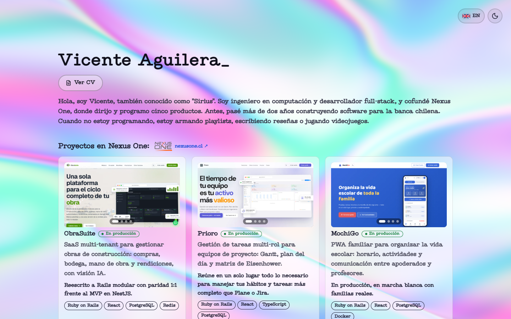

# Portafolio de Vicente Aguilera

Portafolio personal bilingüe (español / inglés) de una sola página, con fondos animados WebGL, modo claro y oscuro y visor de CV embebido.


[Demo](https://portfolio.iamsirius.cl)

<p align="center"></p>

## Tabla de contenidos

- [Descripción](#descripción)
- [Estado del proyecto](#estado-del-proyecto)
- [Características](#características)
- [Tecnologías](#tecnologías)
- [Requisitos](#requisitos)
- [Instalación](#instalación)
- [Uso](#uso)
- [Estructura del proyecto](#estructura-del-proyecto)
- [Licencia](#licencia)
- [Autor](#autor)

## Descripción

Sitio estático construido con React y Vite que presenta mi perfil, experiencia, proyectos y stack tecnológico. Los textos viven en `src/content.js` como pares `{ es, en }`, y en producción se sirve con nginx dentro de Docker.

## Estado del proyecto

**Activo.** Sitio en producción en [portfolio.iamsirius.cl](https://portfolio.iamsirius.cl), con mantenimiento y actualizaciones continuas.

## Características

- **Fondos animados WebGL**: Dither (modo oscuro) e Iridescence (modo claro), ambos con interacción con el mouse.
- **Español / inglés**: botón con la bandera del idioma destino; recuerda la elección.
- **Tema claro/oscuro**: respeta la preferencia del sistema y recuerda la elección.
- **Visor de CV**: `<dialog>` nativo con el PDF embebido en escritorio; en móvil abre el PDF directo. Botón de descarga aparte.
- **Movimiento**: scroll suave con [Lenis](https://lenis.darkroom.engineering/), intro, revelado por sección y tilt de tarjetas con [anime.js](https://animejs.com/) (`src/motion.js`).
- **Movimiento reducido**: con `prefers-reduced-motion` se desactivan Lenis, las animaciones de anime.js, los fondos WebGL y el cursor.
- **Carga diferida**: los fondos WebGL se cargan en un chunk aparte para que el texto pinte primero.
- **Tipografía personalizada**: fuente `Type Machine` (woff2 con subset latino) en `public/font/`.
- **Diseño responsive**: breakpoints para tablet (768px) y móvil (480px).

## Tecnologías

- [React](https://react.dev/) 19 y [Vite](https://vite.dev/) 8
- [Tailwind CSS](https://tailwindcss.com/) 4
- [React Bits](https://reactbits.dev/) (componentes Dither e Iridescence)
- [Three.js](https://threejs.org/), [@react-three/fiber](https://r3f.docs.pmnd.rs/) y [@react-three/postprocessing](https://github.com/pmndrs/react-postprocessing)
- [OGL](https://github.com/oframe/ogl)
- [Lenis](https://lenis.darkroom.engineering/) y [anime.js](https://animejs.com/)
- [Lucide React](https://lucide.dev/) y [simple-icons](https://simpleicons.org/)
- Docker y nginx

## Requisitos

- [Node.js](https://nodejs.org/) (LTS actual) y npm
- Docker (opcional, para el despliegue)

## Instalación

```bash
git clone https://github.com/ViceAguilera/portafolio_2026.git
cd portafolio_2026
npm install
```

## Uso

| Comando | Descripción |
| --- | --- |
| `npm run dev` | Servidor de desarrollo con hot reload (puerto 9666) |
| `npm run build` | Build de producción en `dist/` |
| `npm run preview` | Sirve el build generado para probarlo localmente |

### Docker

```bash
docker compose up -d --build                  # producción (nginx), puerto 9666 por defecto
docker compose --profile dev up app-dev       # desarrollo con hot reload, puerto 9667 por defecto
```

El puerto se puede cambiar con `PORTFOLIO_PORT` y `PORTFOLIO_DEV_PORT`.

## Estructura del proyecto

```text
docker/nginx/        Configuración de nginx del contenedor y del VPS
public/
  CV/                CV en PDF
  font/              Fuente Type Machine
  img/               Favicon, logos e imágenes de proyectos
src/
  components/        Dither e Iridescence (React Bits)
  styles/            Estilos base, variables, tipografía y animaciones
  App.jsx            Composición de la página
  content.js         Textos y datos (es/en)
  i18n.js            Manejo de idioma
  motion.js          Animaciones y scroll
  Carousel.jsx, Experience.jsx, LangToggle.jsx, TechChip.jsx
Dockerfile           Build multi-etapa (dev, build, prod con nginx)
docker-compose.yml   Servicios app (prod) y app-dev
components.json      Registry de React Bits para el CLI de shadcn
```

## Licencia

Distribuido bajo la licencia MIT. Ver [LICENSE](LICENSE).

## Autor

**Vicente Aguilera Arias** — [Portafolio](https://portfolio.iamsirius.cl) · [GitHub](https://github.com/ViceAguilera) · [LinkedIn](https://www.linkedin.com/in/vicenteaguilera/)
